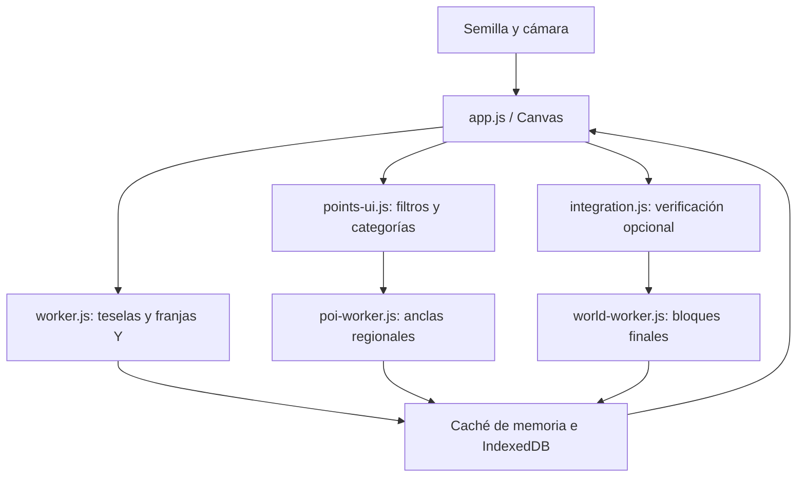

# Arquitectura

## Flujo de una vista

El servidor sirve archivos estáticos y no calcula mapas. Los workers leen perfiles numéricos desde `site/engine/` y `site/data/`; las partes pesadas se descargan cuando hacen falta.

## Interfaz

`index.html` carga scripts clásicos con `defer`. `app.js` define la cámara, Canvas, semilla, teselas y planificación; `integration.js` conecta las verificaciones; `poi-labels.js` define nombres, familias y rarezas; `icon-art.js` gestiona PNG locales y marcos; `points-ui.js` añade selección, iconos y consultas; `ui.js` organiza pestañas, panel móvil, detalle de puntos y proyección por alturas. Mantén ese orden si cambias la estructura. Los workers usan `importScripts` y los módulos del motor exponen clases globales, además de exportaciones CommonJS para las pruebas de Node.

Las categorías se construyen con `details/summary`. `poiGroup` conserva qué grupos se han abierto durante la sesión y crea sus hijos al expandirlos. La búsqueda o un filtro explícito abre los resultados. Plegar una categoría no oculta los puntos seleccionados del mapa.

Los iconos son canvases reutilizados, no imágenes remotas. El orden de dibujo se conserva hasta que cambian los puntos o la semilla, evitando ordenar todo el catálogo en cada movimiento de cámara. `paintedPointIds` evita dibujar dos veces el mismo punto sin ocultar tipos por nivel de zoom. Los puntos que coinciden espacialmente pueden superponerse; la persona decide qué tipos mostrar.

## Teselas y subsuelo

`worker.js` produce una previsualización y una tesela final según la resolución planificada por la cámara. Cada muestra conserva el bioma y una lista de cambios de entorno a lo largo de Y=0..319. `strata.js` aplica las capas nativas y las comprime en franjas. La interfaz crea y reutiliza una imagen de la altura elegida sin volver a calcular el generador.

Las teselas se guardan en IndexedDB antes de transferir sus ArrayBuffers al hilo principal. La transferencia evita otra copia de los mismos buffers. Una petición de semilla/vista nueva invalida los trabajos obsoletos. Los datos del subsuelo se generan a cualquier zoom, sin activar el motor completo de cuevas.

## Anclas de prefabs

`poi-worker.js` selecciona patrones superficiales, estructuras únicas y geometría de nodos de cuevas. `poi-contents.js` transforma las entradas locales del índice ligero según rotación, altura y ajuste al terreno. Las decoraciones subterráneas reutilizan `cave-populate.js` con alturas compactas de columnas en lugar de descargar buffers de bloques.

Se publican primero las anclas de superficie. Los resultados regionales se guardan por perfil, semilla, tamaño y origen; una consulta que contiene tipos ya calculados reutiliza esos resultados y añade solo los tipos que faltan. Los grafos de cuevas también se conservan en memoria. Las regiones densas son menores para reducir el tiempo hasta el primer resultado, no para limitar dónde se pueden generar objetos.

El índice incluye entradas de buffer garantizadas y marcadores elegibles de un solo rol, sin desplazamiento horizontal aleatorio. Se expanden hijos deterministas con una sola opción y sin condiciones heredadas de altura. El resto se resuelve en el cálculo detallado. Por eso una ancla ligera y un bloque final confirmado son estados distintos.

## Mundo detallado

El orden es terreno → cuevas y decoraciones → prefabs superficiales y únicos → agua interna. `world.js` coordina esas fases; las condiciones, prioridades, máscaras, soportes, rotaciones y RNG permanecen en `engine/`.

`integration.js` solicita lotes cercanos al centro de la vista, hasta 64 chunks por lote, sin crear un array enorme con todos los chunks del viewport. El worker conserva resúmenes y los guarda en IndexedDB. Devuelve recursos agrupados, estructuras y marcadores, no las matrices completas de entorno: la capa geográfica del subsuelo utiliza sus propias franjas.

## Cachés e invalidación

| Caché              | Identidad                                                                                 |
| ------------------ | ----------------------------------------------------------------------------------------- |
| Teselas            | Versión de representación, perfil, semilla y clave de tesela.                             |
| Anclas             | Versión del índice, `datasetId`, revisión del índice, semilla, tamaño y origen de región. |
| Bloques detallados | Versión del resumen, `datasetId`, semilla y coordenadas de chunk.                         |
| Prefabs            | Identificador ligado al contenido, con límite de memoria en bytes.                        |

El navegador puede borrar IndexedDB por su política de almacenamiento. Cambiar un filtro reutiliza lo disponible, pero un lugar/tipo nuevo o una caché desalojada puede requerir cálculo. Cambia los prefijos de versión si modificas la semántica de los datos guardados. Los perfiles detallados rechazan extracciones con `datasetId` incompatibles.

## Minerales y alturas

`tools/build-ore-profile.cjs` extrae las fuentes de relleno mineral del perfil nativo y crea `data/ore-sources.json` y `engine/ore-kernel.json.gz`. Esta proyección conserva los generadores y condiciones de los siete tipos de depósito identificados, sin salas ni buffers de bloques. `ore-deposits.js` emite primero puntos de geometría previstos. Son diferentes de los bloques finales confirmados: las máscaras, otras fases y el terreno pueden alterar el resultado.

La ruta completa resume conteos y una posición de bloque por altura para cada mineral/chunk. `projectOrePoint` filtra esos datos y escoge coordenadas reales de la altura solicitada. Los huecos entre niveles ocupados no se presentan como bloques existentes. El desglose de alturas se puede desplegar en el detalle del punto.

El worker del mapa comparte las posiciones climáticas que ya calculó. `setSeed` solo acepta ese estado si coinciden semilla de 32 bits, `datasetId`, zonas, radios y colores; si no, vuelve a la búsqueda normal. No se sustituyen los cálculos por una aproximación.

Las regiones pequeñas pueden heredar puntos y tipos ya completados de su región padre para evitar repetir las estructuras al activar un mineral. Las estructuras de cuevas se agrupan por complejo/tipo. Las decoraciones se calculan solo cuando pueden aportar los tipos solicitados, y se conservan para selecciones posteriores.

La agrupación visual de minerales usa celdas alineadas al mundo, conserva todos sus miembros y puede desactivarse a cualquier zoom. Los filtros de altura y esta agrupación solo procesan datos guardados; no programan generación nueva.
